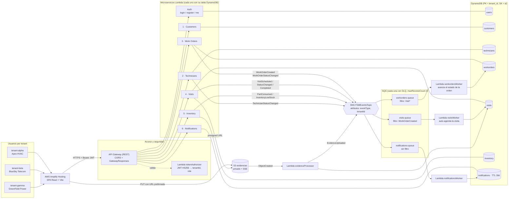
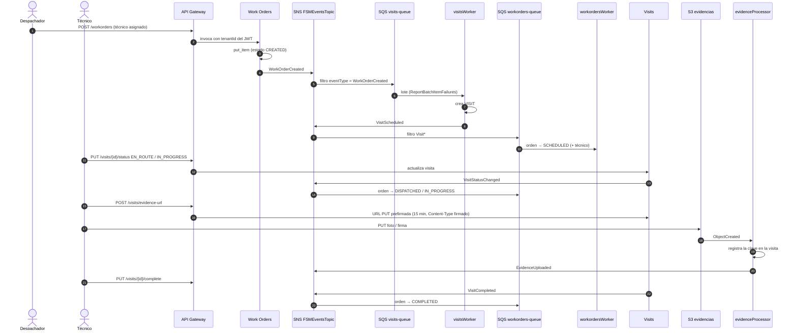
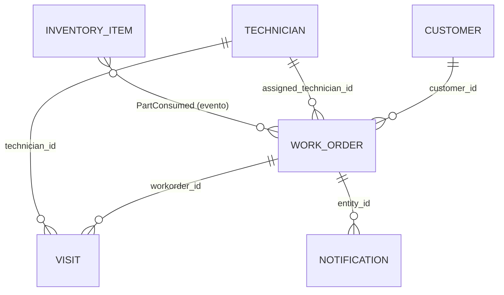

# Arquitectura de Solución OpenFSM

## 1. Descripción general

OpenFSM es un SaaS multi-tenant de **Field Service Management (FSM)**: coordina clientes, técnicos, órdenes de trabajo, visitas en campo, inventario de repuestos y notificaciones. Es 100 % **serverless** (API Gateway + Lambda + DynamoDB), **orientado a eventos** (SNS + SQS + eventos de S3) y se despliega completo con **Serverless Framework** usando el rol `LabRole` de AWS Academy.

**Persistencia:** todos los microservicios usan **Amazon DynamoDB** (una tabla por microservicio). El proyecto **no usa Amazon RDS**; el enunciado permite SQL o NoSQL y se eligió NoSQL, por lo que el entregable de diseño de datos es la **estructura JSON por microservicio** (sección 6).

---

## 2. Diagrama de arquitectura de solución



---

## 3. Multi-tenancy

Tres tenants base: `tenant-alpha` (Apex HVAC Solutions), `tenant-beta` (BlueSky Telecom Services) y `tenant-gamma` (GreenField Electrical & Power).

1. **Identidad:** `POST /auth/login` emite un JWT HS256 (8 h) con `tenant_id`, `sub`, `role` (`ADMIN`, `DISPATCHER`, `TECHNICIAN`) y `exp`.
2. **Authorizer:** `tokenAuthorizer` valida firma, algoritmo (`HS256`), expiración, claims y rol, e inyecta `tenantId`, `userId` y `role` en `requestContext.authorizer`.
3. **Datos:** los handlers **solo** leen el tenant del contexto del authorizer (nunca del body ni de headers) y todas las consultas son `Query` sobre la partición `tenant_id`. Los tokens de paginación se validan contra el tenant del usuario.
4. **Eventos:** cada mensaje lleva `tenant_id`; los workers escriben únicamente en esa partición.
5. **Archivos:** las evidencias se guardan bajo `<tenant_id>/visits/<visit_id>/…` y el backend rechaza claves fuera de ese prefijo.

### Autorización por rol

| Acción | ADMIN | DISPATCHER | TECHNICIAN |
| :--- | :---: | :---: | :---: |
| Listar / ver cualquier recurso del tenant | ✓ | ✓ | ✓ |
| Crear clientes, técnicos, repuestos, órdenes y visitas | ✓ | ✓ | – |
| Reasignar técnico o cancelar una orden | ✓ | ✓ | – |
| Cambiar estado de orden, check-in / cierre de visita, consumir repuestos, subir evidencias | ✓ | ✓ | ✓ |
| Eliminar clientes, registrar usuarios | ✓ | – | – |

---

## 4. Arquitectura orientada a eventos (EDA)

Un único tópico SNS actúa como bus de eventos de dominio. Cada consumidor tiene su **propia cola SQS con DLQ** y una **FilterPolicy** sobre el atributo `eventType`, de modo que los microservicios no se llaman entre sí ni escriben en tablas ajenas.

### 4.1 Catálogo de eventos

| Evento | Productor | Consumidores | Efecto |
| :--- | :--- | :--- | :--- |
| `WorkOrderCreated` | Work Orders | visitsWorker, notificationsWorker | Si la orden tiene técnico, se agenda automáticamente la primera visita |
| `WorkOrderStatusChanged` | Work Orders (API y worker) | notificationsWorker | Notificación de cambio de estado |
| `VisitScheduled` | Visits (API y visitsWorker) | workordersWorker, notificationsWorker | La orden pasa a `SCHEDULED` y se le asigna el técnico |
| `VisitStatusChanged` | Visits (`EN_ROUTE`, `IN_PROGRESS`) | workordersWorker, notificationsWorker | La orden pasa a `DISPATCHED` / `IN_PROGRESS` |
| `VisitCompleted` | Visits | workordersWorker, notificationsWorker | La orden pasa a `COMPLETED` |
| `EvidenceUploaded` | evidenceProcessor (evento S3) | notificationsWorker | Foto o firma registrada en la visita |
| `PartConsumed` | Inventory | notificationsWorker | Registro de consumo |
| `InventoryLowStock` | Inventory | notificationsWorker | Alerta al cruzar el punto de reorden |
| `TechnicianStatusChanged` | Technicians | notificationsWorker | Disponibilidad del técnico |

Formato de cada mensaje (cuerpo SNS, entregado *raw* a SQS):

```json
{
  "event_id": "9f1c…",
  "event_type": "VisitCompleted",
  "tenant_id": "tenant-alpha",
  "occurred_at": "2026-11-20T15:04:05+00:00",
  "visit_id": "VISIT#alph-000123",
  "workorder_id": "WO#alph-000123",
  "checklist_passed": 3,
  "checklist_total": 3,
  "evidence_count": 2,
  "has_signature": true
}
```

### 4.2 Flujo: orden con técnico → visita automática → cierre



### 4.3 Garantías de resiliencia

- **Reintentos parciales:** los workers devuelven `batchItemFailures`; solo los mensajes fallidos vuelven a la cola y, tras 3 intentos, pasan a su DLQ (retención de 14 días).
- **Idempotencia:** la visita automática usa un ID derivado del `event_id`, las notificaciones usan `NOTIF#<fecha>#<event_id>` y los `put_item` son condicionales (`attribute_not_exists`). Reentregas de SQS no duplican registros.
- **Estados solo hacia adelante:** `workordersWorker` aplica `CREATED → SCHEDULED → DISPATCHED → IN_PROGRESS → COMPLETED` con control optimista (`expect status`). Nunca retrocede una orden ni toca las canceladas.
- **Publicación no bloqueante:** si SNS falla, la escritura en DynamoDB ya está hecha, la respuesta HTTP no se rompe y el error queda en CloudWatch.

---

## 5. Microservicios y endpoints

| Microservicio | Método | Endpoint | Roles | Descripción |
| :--- | :--- | :--- | :--- | :--- |
| Auth | POST | `/auth/login` | público | Emite el JWT del tenant |
| Auth | POST | `/auth/register` | ADMIN | Crea un usuario en el tenant del token |
| Auth | GET | `/auth/me` | todos | Sesión actual |
| Customers | GET / POST | `/customers` | todos / ADMIN, DISPATCHER | Listado paginado / alta |
| Customers | GET / DELETE | `/customers/{id}` | todos / ADMIN | Detalle / baja |
| Technicians | GET / POST | `/technicians` | todos / ADMIN, DISPATCHER | Listado / alta |
| Technicians | GET | `/technicians/{id}` | todos | Detalle |
| Technicians | PUT | `/technicians/{id}/status` | todos | Disponibilidad y GPS → `TechnicianStatusChanged` |
| Work Orders | GET / POST | `/workorders` | todos / ADMIN, DISPATCHER | Listado / alta → `WorkOrderCreated` |
| Work Orders | GET | `/workorders/{id}` | todos | Detalle |
| Work Orders | PUT | `/workorders/{id}/status` | todos (reasignar/cancelar: ADMIN, DISPATCHER) | Estado → `WorkOrderStatusChanged` |
| Visits | GET / POST | `/visits` | todos / ADMIN, DISPATCHER | Listado / agendar → `VisitScheduled` |
| Visits | GET | `/visits/{id}` | todos | Detalle |
| Visits | PUT | `/visits/{id}/status` | todos | Check-in `EN_ROUTE` / `IN_PROGRESS` → `VisitStatusChanged` |
| Visits | PUT | `/visits/{id}/complete` | todos | Cierre con checklist, notas, evidencias, firma → `VisitCompleted` |
| Visits | POST | `/visits/evidence-url` | todos | URL PUT prefirmada (jpeg, png, webp, heic, pdf) |
| Inventory | GET / POST | `/inventory` | todos / ADMIN, DISPATCHER | Listado / alta |
| Inventory | GET | `/inventory/{id}` | todos | Detalle |
| Inventory | POST | `/inventory/consume` | todos | Descuento atómico → `PartConsumed`, `InventoryLowStock` |
| Notifications | GET | `/notifications` | todos | Feed del tenant (más recientes primero) |

Funciones asíncronas: `visitsWorker`, `workordersWorker` y `notificationsWorker` (SQS), además de `evidenceProcessor` (S3).

**Listados:** `?limit=` (máx. 500) y `?next_token=` (opaco, devuelto por la respuesta anterior).

**Formato de respuesta:**

```json
{ "success": true, "message": "Success", "data": { "items": [], "count": 0, "next_token": null } }
{ "success": false, "error": { "code": "FORBIDDEN", "message": "Tu rol no tiene permiso para esta acción" } }
```

---

## 6. Diseño de datos (DynamoDB, estructura JSON por microservicio)

Todas las tablas usan `BillingMode: PAY_PER_REQUEST`, **clave de partición `tenant_id`** y **clave de ordenamiento `id`**. Nombres: `openfsm-<userCode>-<stage>-<tabla>`. El seed carga **10 000 registros por tenant en cada tabla (30 000 por microservicio)**.

### 6.1 Customers (`…-customers`)
```json
{
  "tenant_id": "tenant-alpha",
  "id": "CUST#alph-000001",
  "name": "Corporación Logística Andina",
  "tax_id": "20914763202",
  "email": "contacto.sede1@tenant-alpha.com",
  "phone": "+51 942868828",
  "service_address": "Av. Benavides 304",
  "city": "Lima",
  "postal_code": "15001",
  "contract_type": "ENTERPRISE",
  "status": "ACTIVE",
  "created_at": "2026-09-01T08:12:00+00:00",
  "updated_at": "2026-09-01T08:12:00+00:00"
}
```

### 6.2 Technicians (`…-technicians`)
```json
{
  "tenant_id": "tenant-alpha",
  "id": "TECH#alph-000001",
  "name": "Carlos Rodríguez",
  "email": "carlos.rodriguez1@tenant-alpha.com",
  "phone": "+51 984512390",
  "specialty": "Chiller Repair",
  "skills": ["Chiller Repair", "Safety Level 2", "Diagnostic Tools"],
  "certification_level": "SENIOR",
  "vehicle_id": "VEH-TE-101",
  "status": "AVAILABLE",
  "current_latitude": "-12.046374",
  "current_longitude": "-77.042793",
  "created_at": "2026-08-01T08:15:00+00:00",
  "updated_at": "2026-08-01T08:15:00+00:00"
}
```

### 6.3 Work Orders (`…-workorders`)
```json
{
  "tenant_id": "tenant-alpha",
  "id": "WO#alph-000001",
  "customer_id": "CUST#alph-000001",
  "assigned_technician_id": "TECH#alph-000001",
  "title": "[HVAC] AC unit blowing lukewarm air in server room",
  "description": "AC unit blowing lukewarm air in server room. Reported at customer location.",
  "priority": "HIGH",
  "status": "IN_PROGRESS",
  "sla_due_date": "2026-11-08T20:12:00+00:00",
  "estimated_hours": 3.5,
  "created_by": "USR-A-002",
  "created_at": "2026-11-08T08:08:00+00:00",
  "updated_at": "2026-11-08T09:30:00+00:00"
}
```
`priority`: `LOW | NORMAL | HIGH | EMERGENCY` · `status`: `CREATED | SCHEDULED | DISPATCHED | IN_PROGRESS | COMPLETED | CANCELLED`

### 6.4 Visits (`…-visits`)
```json
{
  "tenant_id": "tenant-alpha",
  "id": "VISIT#alph-000001",
  "workorder_id": "WO#alph-000001",
  "technician_id": "TECH#alph-000001",
  "scheduled_start": "2026-11-08T10:00:00+00:00",
  "scheduled_end": "2026-11-08T13:00:00+00:00",
  "actual_start": "2026-11-08T10:05:00+00:00",
  "actual_end": "2026-11-08T12:45:00+00:00",
  "status": "COMPLETED",
  "notes": "Inspección realizada. Parámetros dentro de tolerancia.",
  "checklist": [
    { "item": "EPP verificado", "passed": true },
    { "item": "Diagnóstico del equipo", "passed": true },
    { "item": "Conformidad del cliente", "passed": true }
  ],
  "evidence_photos": ["tenant-alpha/visits/VISIT#alph-000001/1731060000_before.jpg"],
  "signature_key": "tenant-alpha/visits/VISIT#alph-000001/1731060300_signature.png",
  "created_at": "2026-11-08T08:30:00+00:00",
  "updated_at": "2026-11-08T12:45:00+00:00"
}
```
`status`: `SCHEDULED | EN_ROUTE | IN_PROGRESS | COMPLETED`. Las claves de evidencias son objetos del bucket privado de S3.

### 6.5 Inventory (`…-inventory`)
```json
{
  "tenant_id": "tenant-alpha",
  "id": "PART#alph-000001",
  "sku": "COMP-501-00001",
  "name": "Rotary Compressor 5HP Model 1",
  "category": "Compressors",
  "unit_cost": 450.0,
  "unit_price": 750.0,
  "stock_quantity": 84,
  "warehouse_location": "Warehouse-B-Bay-14",
  "reorder_point": 15,
  "created_at": "2026-10-25T08:10:00+00:00",
  "updated_at": "2026-11-08T11:00:00+00:00"
}
```

### 6.6 Notifications (`…-notifications`)
```json
{
  "tenant_id": "tenant-alpha",
  "id": "NOTIF#2026-11-08T12:45:10+00:00#9f1c2a7b3d4e",
  "event_type": "VisitCompleted",
  "severity": "SUCCESS",
  "title": "Visita alph-000001 completada",
  "detail": "Checklist 3/3 · 2 evidencias · con firma",
  "entity_id": "WO#alph-000001",
  "created_at": "2026-11-08T12:45:10+00:00",
  "expires_at": 1733660710
}
```
`severity`: `INFO | SUCCESS | WARNING | CRITICAL`. `expires_at` activa el TTL de DynamoDB (30 días). La clave de ordenamiento empieza con la fecha, así el feed sale ordenado.

### 6.7 Users (`…-users`, servicio Auth)
```json
{
  "tenant_id": "tenant-alpha",
  "id": "USER#dispatcher",
  "username": "dispatcher",
  "full_name": "Demo Dispatcher Apex HVAC Solutions",
  "role": "DISPATCHER",
  "password_hash": "pbkdf2$60000$<salt>$<hash>",
  "created_at": "2026-11-08T08:00:00+00:00"
}
```

### 6.8 Relaciones lógicas entre microservicios

No hay claves foráneas entre tablas: cada servicio es dueño de sus datos y se referencia a otros por ID dentro del mismo tenant.



---

## 7. Seguridad

- JWT HS256 con secreto **obligatorio** (`JWT_SECRET`, sin valor por defecto); el authorizer rechaza `alg` distinto de HS256, firmas inválidas, tokens expirados y roles desconocidos.
- Contraseñas con PBKDF2-HMAC-SHA256 (60 000 iteraciones, salt aleatorio).
- `/auth/register` protegido (solo ADMIN, en el tenant de su token). El login devuelve el mismo error para un usuario inexistente o una contraseña errónea.
- Los IDs de los registros los genera el servidor y las altas son condicionales, así que no se puede sobrescribir un registro enviando su ID.
- Validación de tipos, enums, longitudes y rangos en todos los endpoints. Los errores 500 no exponen detalles internos.
- Bucket S3 privado (Block Public Access + SSE-S3). Las URLs prefirmadas duran 15 min, tienen el `Content-Type` firmado y solo se aceptan claves dentro del prefijo del tenant y de la visita.
- Las colas SQS solo aceptan mensajes del servicio SNS y del tópico propio (`aws:SourceArn`).
- `GatewayResponses` 4XX/5XX con CORS para que el cliente distinga un 401 de un error de red.

---

## 8. Despliegue (AWS Academy)

Ver [DEPLOY.md](DEPLOY.md). Resumen: todas las Lambdas usan `arn:aws:iam::<account>:role/LabRole` (no se crean roles IAM). Los recursos se nombran `openfsm-<userCode>-<stage>-*` y el bucket agrega el `accountId` para que su nombre sea único a nivel global.
