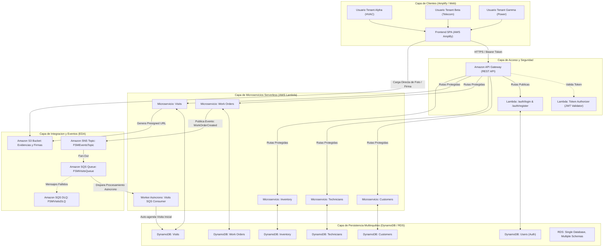
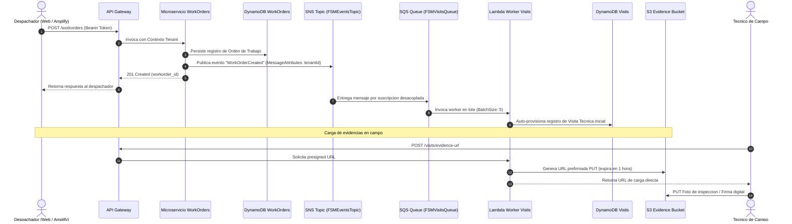
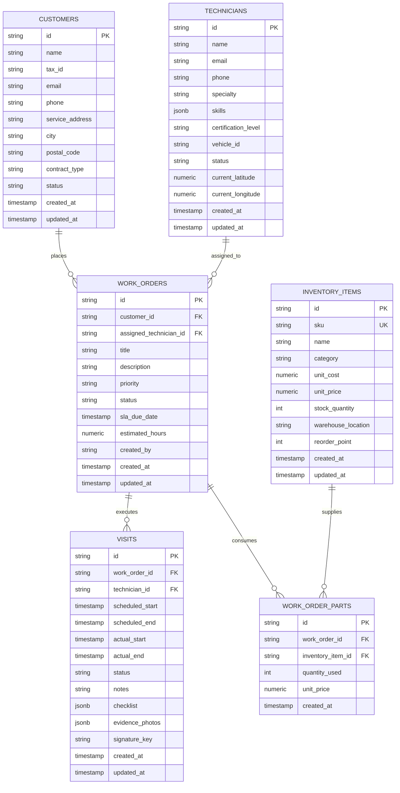

# Arquitectura de Solucion OpenFSM

## 1. Descripcion General

OpenFSM es una plataforma Software as a Service (SaaS) multinquilino (multi-tenant) orientada a la gestion de servicios de campo (Field Service Management - FSM). Permite coordinar clientes, tecnicos, ordenes de trabajo, visitas e inventario de repuestos bajo un modelo serverless y orientado a eventos (Event-Driven Architecture - EDA).

Toda la infraestructura esta concebida para operar en Amazon Web Services (AWS), automatizada mediante Serverless Framework, sujeta a politicas de ejecucion con el rol academico `LabRole` y parametrizada con el codigo identificador de usuario (`userCode`).

---

## 2. Diagrama de Arquitectura de Solucion



---

## 3. Modelo de Aislamiento Multi-Tenancy

El sistema garantiza aislamiento logico de datos para multiples inquilinos. En este proyecto se configuran tres inquilinos base:
1. `tenant-alpha`: Apex HVAC Solutions (Sistemas de climatizacion y refrigeracion industrial).
2. `tenant-beta`: BlueSky Telecom Services (Redes de fibra optica y torres de comunicacion).
3. `tenant-gamma`: GreenField Electrical & Power (Subestaciones y distribucion de energia electrica).

### Mecanismo de Aislamiento en Runtime
1. **Autenticacion y Claims:** El endpoint `/auth/login` valida credenciales y genera un JSON Web Token (JWT) firmado con algoritmo HMAC-SHA256. El payload contiene:
   - `tenant_id`: Identificador unico del inquilino (`tenant-alpha`, `tenant-beta`, etc.).
   - `sub`: Identificador de usuario.
   - `role`: Rol del usuario (`ADMIN`, `DISPATCHER`, `TECHNICIAN`).
   - `exp`: Tiempo de expiracion de sesion (24 horas).
2. **Lambda Authorizer:** Intercepta cada solicitud en API Gateway, valida la firma criptografica y extrae el `tenant_id`. API Gateway inyecta estos valores en `requestContext.authorizer`.
3. **Acceso a Base de Datos:** Los controladores de los microservicios leen estrictamente el `tenant_id` validado por el authorizer y restringen cualquier consulta en DynamoDB o RDS a ese inquilino. Es imposible que un tenant consulte o modifique datos de otro.

---

## 4. Flujo Basado en Eventos (EDA) con SNS, SQS y S3

El desacoplamiento entre microservicios se implementa mediante mensajeria asincrona:



---

## 5. Diseno de Bases de Datos

### 5.1 Opcion NoSQL: Amazon DynamoDB

Cada microservicio cuenta con su propia tabla DynamoDB con modo de facturacion bajo demanda (`PAY_PER_REQUEST`). La clave de particion (`HASH`) es siempre `tenant_id` y la clave de ordenamiento (`RANGE`) es el `id` de la entidad.

#### 1. Customers Table (`openfsm-{userCode}-{stage}-customers`)
- Clave de Particion: `tenant_id` (String)
- Clave de Ordenamiento: `id` (String: `CUST#<tenant_pref>-<numero>`)
- Estructura JSON:
```json
{
  "tenant_id": "tenant-alpha",
  "id": "CUST#tena-000001",
  "name": "Corporacion Logistica Andina",
  "tax_id": "20914763202",
  "email": "contacto.sede1@tenant-alpha.com",
  "phone": "+51 942868828",
  "service_address": "Av. Benavides 304",
  "city": "Lima",
  "postal_code": "15001",
  "contract_type": "ENTERPRISE",
  "status": "ACTIVE",
  "created_at": "2026-01-01T08:12:00+00:00",
  "updated_at": "2026-01-01T08:12:00+00:00"
}
```

#### 2. Technicians Table (`openfsm-{userCode}-{stage}-technicians`)
- Clave de Particion: `tenant_id` (String)
- Clave de Ordenamiento: `id` (String: `TECH#<tenant_pref>-<numero>`)
- Estructura JSON:
```json
{
  "tenant_id": "tenant-alpha",
  "id": "TECH#tena-000001",
  "name": "Carlos Rodriguez",
  "email": "carlos.rodriguez1@tenant-alpha.com",
  "phone": "+51 984512390",
  "specialty": "Chiller Repair",
  "skills": ["Chiller Repair", "Safety Level 2", "Diagnostic Tools"],
  "certification_level": "SENIOR",
  "vehicle_id": "VEH-TE-101",
  "status": "AVAILABLE",
  "current_latitude": "-12.046374",
  "current_longitude": "-77.042793",
  "created_at": "2026-01-01T08:15:00+00:00",
  "updated_at": "2026-01-01T08:15:00+00:00"
}
```

#### 3. Work Orders Table (`openfsm-{userCode}-{stage}-workorders`)
- Clave de Particion: `tenant_id` (String)
- Clave de Ordenamiento: `id` (String: `WO#<tenant_pref>-<numero>`)
- Estructura JSON:
```json
{
  "tenant_id": "tenant-alpha",
  "id": "WO#tena-000001",
  "customer_id": "CUST#tena-000001",
  "assigned_technician_id": "TECH#tena-000001",
  "title": "[HVAC] AC unit blowing lukewarm air in server room",
  "description": "AC unit blowing lukewarm air in server room. Reported at customer location.",
  "priority": "HIGH",
  "status": "IN_PROGRESS",
  "sla_due_date": "2026-01-01T20:12:00+00:00",
  "estimated_hours": 3.5,
  "created_by": "dispatcher-tenant-alpha",
  "created_at": "2026-01-01T08:08:00+00:00",
  "updated_at": "2026-01-01T08:08:00+00:00"
}
```

#### 4. Visits Table (`openfsm-{userCode}-{stage}-visits`)
- Clave de Particion: `tenant_id` (String)
- Clave de Ordenamiento: `id` (String: `VISIT#<tenant_pref>-<numero>`)
- Estructura JSON:
```json
{
  "tenant_id": "tenant-alpha",
  "id": "VISIT#tena-000001",
  "workorder_id": "WO#tena-000001",
  "technician_id": "TECH#tena-000001",
  "scheduled_start": "2026-01-01T10:00:00+00:00",
  "scheduled_end": "2026-01-01T13:00:00+00:00",
  "actual_start": "2026-01-01T10:05:00+00:00",
  "actual_end": "2026-01-01T12:45:00+00:00",
  "status": "COMPLETED",
  "notes": "Field inspection executed. Parameters verified within manufacturer tolerance.",
  "checklist": [
    {"item": "Personal Protective Equipment Verified", "passed": true},
    {"item": "System Diagnostic Self-Test", "passed": true},
    {"item": "Customer Signoff Received", "passed": true}
  ],
  "evidence_photos": [
    "s3://openfsm-u202112345-dev-evidence/tenant-alpha/visits/WO#tena-000001/before.jpg"
  ],
  "signature_key": "s3://openfsm-u202112345-dev-evidence/tenant-alpha/visits/WO#tena-000001/signature.png",
  "created_at": "2026-01-01T10:00:00+00:00",
  "updated_at": "2026-01-01T12:45:00+00:00"
}
```

#### 5. Inventory Table (`openfsm-{userCode}-{stage}-inventory`)
- Clave de Particion: `tenant_id` (String)
- Clave de Ordenamiento: `id` (String: `PART#<tenant_pref>-<numero>`)
- Estructura JSON:
```json
{
  "tenant_id": "tenant-alpha",
  "id": "PART#tena-000001",
  "sku": "COMP-501-00001",
  "name": "Rotary Compressor 5HP Model 1",
  "category": "Compressors",
  "unit_cost": 450.0,
  "unit_price": 750.0,
  "stock_quantity": 84,
  "warehouse_location": "Warehouse-B-Bay-14",
  "reorder_point": 15,
  "created_at": "2026-01-01T08:10:00+00:00",
  "updated_at": "2026-01-01T08:10:00+00:00"
}
```

---

### 5.2 Opcion SQL: Amazon RDS (Single Database, Multiple Schemas)

Para entornos relacionales, la base de datos implementa el patron Single Database, Multiple Schemas en PostgreSQL / MySQL. Cada tenant posee su propio esquema aislado (`tenant_alpha`, `tenant_beta`, `tenant_gamma`), compartiendo la misma instancia fisica pero sin visibilidad entre esquemas.

#### Diagrama Entidad-Relacion por Microservicio



El script DDL completo esta disponible en [schema_tenant_rds.sql](file:///home/lazheart/Desktop/OpenFSM/ingest/sql/schema_tenant_rds.sql).

---

## 6. Microservicios y Endpoints API

| Microservicio | Metodo | Endpoint | Protegido | Descripcion |
| :--- | :--- | :--- | :--- | :--- |
| **Auth** | POST | `/auth/login` | No | Autentica usuario y genera token JWT de tenant |
| **Auth** | POST | `/auth/register` | No | Registra usuario con rol en el tenant |
| **Auth** | GET | `/auth/me` | Si | Retorna sesion y contexto del usuario |
| **Customers** | GET | `/customers` | Si | Lista clientes del tenant activo |
| **Customers** | POST | `/customers` | Si | Registra nuevo cliente en el tenant |
| **Customers** | GET | `/customers/{id}` | Si | Obtiene detalle de cliente |
| **Customers** | DELETE | `/customers/{id}` | Si | Elimina cliente dentro del tenant |
| **Technicians** | GET | `/technicians` | Si | Lista tecnicos de campo del tenant |
| **Technicians** | POST | `/technicians` | Si | Registra tecnico, habilidades y vehiculo |
| **Technicians** | GET | `/technicians/{id}` | Si | Obtiene ficha de tecnico |
| **Technicians** | PUT | `/technicians/{id}/status` | Si | Actualiza estado operacional y coordenadas GPS |
| **Work Orders** | GET | `/workorders` | Si | Lista ordenes de trabajo del tenant |
| **Work Orders** | POST | `/workorders` | Si | Crea orden de trabajo y emite evento SNS `WorkOrderCreated` |
| **Work Orders** | GET | `/workorders/{id}` | Si | Consulta detalle de orden de trabajo |
| **Work Orders** | PUT | `/workorders/{id}/status` | Si | Actualiza estado y emite evento SNS `WorkOrderStatusChanged` |
| **Visits** | GET | `/visits` | Si | Lista visitas de campo del tenant |
| **Visits** | POST | `/visits` | Si | Agenda visita de campo manual |
| **Visits** | GET | `/visits/{id}` | Si | Obtiene detalle de visita |
| **Visits** | PUT | `/visits/{id}/complete` | Si | Finaliza visita, registra checklist y firma |
| **Visits** | POST | `/visits/evidence-url` | Si | Genera URL prefirmada de subida en S3 |
| **Visits Worker** | SQS | Event Driven | N/A | Consume eventos SNS faneados a SQS para auto-agendamiento |
| **Inventory** | GET | `/inventory` | Si | Lista catalogo de repuestos y stock del tenant |
| **Inventory** | POST | `/inventory` | Si | Registra nuevo item de inventario |
| **Inventory** | GET | `/inventory/{id}` | Si | Detalle de item de inventario |
| **Inventory** | POST | `/inventory/consume` | Si | Consume stock de repuesto asociado a una orden |

---

## 7. Despliegue con Serverless Framework y AWS LabRole

El archivo [serverless.yml](file:///home/lazheart/Desktop/OpenFSM/back/serverless.yml) implementa las restricciones del entorno AWS Academy Learner Lab:
1. **Rol IAM existente:** Utiliza `arn:aws:iam::${aws:accountId}:role/LabRole` a nivel de proveedor, impidiendo la creacion no autorizada de roles IAM.
2. **Prefijo por Usuario:** Los nombres de servicios, tablas DynamoDB, bucket S3, topico SNS y colas SQS incluyen `${self:custom.userCode}` (por ejemplo, `u202112345`), evitando colisiones en cuentas compartidas.
3. **Comando de Despliegue:**
   ```bash
   cd back
   serverless deploy --stage dev --param="userCode=u202112345" --region us-east-1
   ```

